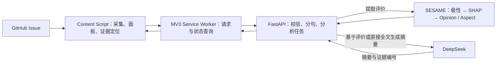

# SEED 技术设计

以下为 V1 拟采用的设计。模型版本、分析限额和 SHAP 候选策略在真实 Issue 上试跑后确定。

## 组件和数据流

| 组件 | 职责 |
| --- | --- |
| Content Script | 仅在支持的页面挂载 SEED。用 React 和 Tailwind CSS 实现面板，隔离样式。保留标题、作者、评论顺序、GitHub 评论 ID、永久链接及 DOM 定位映射。 |
| Manifest V3 Service Worker | 只向已配置的后端转发请求。为后端主机声明所需权限，避免长推理请求占用 worker。面板持有任务 ID 并查询进度，worker 可随事件重新启动。 |
| FastAPI | 管理运行中的任务，校验输入，分句和维护来源映射，调用 SESAME 适配层和摘要客户端。 |
| SESAME 适配层 | 批量预测极性，针对候选句计算 SHAP，复用现有 Opinion 和 Aspect 提取逻辑，输出证据区间。 |
| DeepSeek 客户端 | 组织结构化评价，验证返回的摘要和证据编号。 |

跨域请求和 worker 生命周期以 Chrome 的扩展文档为准。[跨域请求](https://developer.chrome.com/docs/extensions/develop/concepts/network-requests)、[Service Worker 生命周期](https://developer.chrome.com/docs/extensions/develop/concepts/service-workers/lifecycle)

## 采集与定位

1. 读取 Issue 正文和当前已加载的评论。只读取讨论容器内的文本。提取评价时跳过独立代码块并保留其两侧段落的边界，全文摘要保留代码块。行内代码随原句传入。
2. 为每条正文或评论保存本次分析的消息 ID（`message_id`）、原文快照和文本节点映射。作者、链接等页面元数据由浏览器保存，后端接收当前任务所需的消息字段。V1 以当前 DOM 为边界，全文摘要保留已加载的代码块。后续评估通过 GitHub REST API 补齐分页内容。
3. 后端通过本机 CoreNLP 对每条消息独立执行 `tokenize,ssplit`，并保留 UTF-16 字符区间。每句获得任务内唯一的 `source_id`。传给 SESAME 的空白归一化副本与采集文本按词的位置对齐。
4. 接口以消息文本为基准返回 UTF-16 半开区间 `[start, end)`。Python 内部的字符位置在返回前统一转换。每个区间都能精确切出相应的句子或短语，同一句话在不同评论中有不同的来源 ID。
5. 按消息 ID 滚动到对应正文或评论。待接入片段高亮时，将原文区间映射回 DOM 文本节点，并用 CSS Custom Highlight API 绘制。[CSS Custom Highlight API 规范](https://www.w3.org/TR/css-highlight-api-1/)

## SESAME 接入

| 阶段 | 已有实现与适配工作 |
| --- | --- |
| Sentiment | `EASTER_en.py` 提供 RoBERTa + TextCNN 的英文分类路径。适配层复用 `load_model` 和 `DataGenerator`，初始化时检查权重和标签映射，批量获取负面、中性、正面及对应概率。 |
| SHAP / Opinion | `extract_opinion_en.py` 已有对目标极性计算 SHAP 以及结合句法选择 Opinion 的逻辑。首版先对正面和负面的候选句归因，按目标类别的正向贡献和已有提取规则生成 Opinion。 |
| Aspect | `extract_aspect.py` 调用基于 CoreNLP 的 `SentiAspectExtractor.jar` 做句法匹配。把词元位置转换成原文字符区间。仅使用已对齐到原文的 Opinion 生成卡片，无法确认的 Aspect 设为 `null`。 |

已有研究工作区的 `pipeline/k8s_pipeline.py` 中，`step2_run_sesame` 已串联三个阶段，但依赖离线文件，并按句子文本匹配最终结果。SEED 的适配层按消息和句子次序回填结果，复用 SESAME 的 Opinion 提取器和 Java 的 Opinion–Aspect 配对，保留已对齐到采集文本的片段。每个任务在独立子进程和临时目录中执行，使用 laptop 权重和 `core_extend_type=1`。[SESAME 源码](https://github.com/nexpaliiz554/SESAME)

SHAP 衡量的是词元对模型某一类别输出的贡献。跨句比较受句长、归因基线和输出尺度影响。先记录短、中、长 Issue 的分类、SHAP 和句法耗时、候选数量及抽取覆盖，再确定置信度筛选或候选限额。卡片默认按原讨论顺序展示。

## DeepSeek API Key 设置

悬浮面板通过 Service Worker 查询 Key 是否已保存，并打开扩展自己的 `settings.html`。输入和修改在扩展设置页完成，Service Worker 依据消息来源授予相应操作。请求发往 `127.0.0.1:48729`。本机服务根据 `manifest.json` 的开发用公钥确定扩展来源，并检查来源和请求头。 [Chrome 扩展设置页](https://developer.chrome.com/docs/extensions/develop/ui/options-page)

| 方法 | `/v1/settings/deepseek` |
| --- | --- |
| `GET` | 查询本机 Key 的保存状态。 |
| `PUT` | 接收 `api_key` 并保存或替换。 |
| `DELETE` | 清除保存的 Key。 |

接口统一返回 `configured` 布尔值。Key 仅保存在后端的 `.local/deepseek-api-key`，该目录由 Git 忽略。保存成功表示本机配置已写入，DeepSeek 调用的错误在摘要任务内返回。

## 分析与摘要 API

SEED 在 `127.0.0.1:48729` 接收扩展 Service Worker 的请求。任务接口和缓存查询接受 `X-Seed-Thread`，由 worker 从 GitHub Issue 页地址派生。任务在后台执行，分析和摘要分别限制并发。任务运行状态保存在内存中。完成的评价和摘要写入 `.local/results/`，重启后仍可查询。

| 方法 | 路径 | 输入或状态 |
| --- | --- | --- |
| POST | `/v1/analyses` | `title`、`messages`，返回 `analysis_id`。 |
| GET | `/v1/analyses/{analysis_id}` | 查询本 Issue 的本机分析任务状态。 |
| POST | `/v1/summaries` | `mode: evaluations` 和已完成的 `analysis_id`，或 `mode: full`、`title` 和 `messages`。返回 `summary_id`。 |
| GET | `/v1/summaries/{summary_id}` | 查询本 Issue 的摘要任务状态。 |
| POST | `/v1/cache/lookup` | 使用当前讨论指纹查询缓存的评价和最近摘要。 |

`messages` 按页面中的消息顺序排列，每条包含唯一的 `message_id`、`kind`（`body` 或 `comment`）和 `text`。任务状态为 `queued`、`running`、`completed` 或 `failed`，进行中可返回当前阶段，完成时附 `result`。输入超限或格式不合规返回 `422`，摘要前置条件不满足返回 `409`，服务繁忙返回 `429`，任务查询不到返回 `404`。

提取结果包含消息数、句子数、候选数和 `evaluations`。每张评价卡有 `evaluation_id`、`source_id`、`message_id`、`sentence`、`sentence_span_utf16`、`sentiment`、`confidence`、`opinion`、`aspect`。片段对象沿用 `text` 和 `span_utf16`，无法确认的 Aspect 设为 `null`。

摘要结果的 `mode` 标明摘要依据。`sentences` 中的每项包含 `text` 和 `source_ids`。评价模式引用 `S…`，全文模式引用 `M…`。

## 本机结果缓存

扩展和后端用同一份有序表示对标题、消息 ID、类型和正文计算 SHA-256 指纹。提取和全文摘要按各自的输入计算，评价摘要由已提取的证据和对应分析编号确定。缓存限定在同一个 Issue 内，同时校验相关模型、SESAME 资源或摘要提示的版本。同一份输入的并行提交会接到同一个运行任务。

只有成功结果写入缓存。文件使用临时文件与原子替换，保留输出所需的评价原句、结构化结果和摘要。打开面板仅将指纹提交本机后端，用当前网页的消息映射重新连接证据编号。

## 摘要与数据传输

本机提取仅运行 SESAME。评价摘要从同一 Issue 的已完成任务读取结构化评价及原句，全文摘要从该次请求读取标题和消息文本。用户主动选择摘要模式且没有缓存命中时，后端读取保存的 Key 并调用 DeepSeek Chat Completions。默认模型为 `deepseek-flash`，可通过 `SEED_DEEPSEEK_MODEL` 配置。 [DeepSeek Chat Completions](https://api-docs.deepseek.com/api/create-chat-completion/)

请求使用 JSON 输出模式。后端根据本次输入列出可引用的证据编号，检查返回的句数、字段和编号。遇到空内容、截断、格式错误或未知编号时，发送同一份输入并自动重试一次。只有通过校验的摘要会写入缓存。连续校验失败时，面板保留已有评价卡片。 [DeepSeek JSON Output](https://api-docs.deepseek.com/guides/json_mode/)

